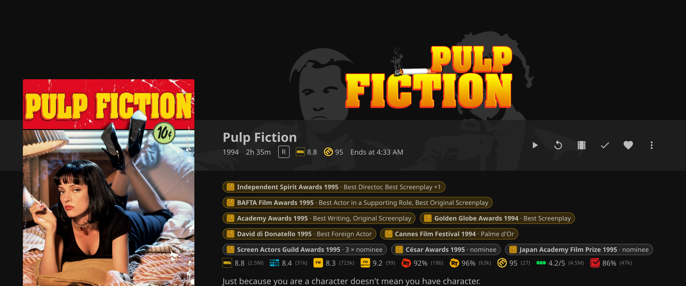
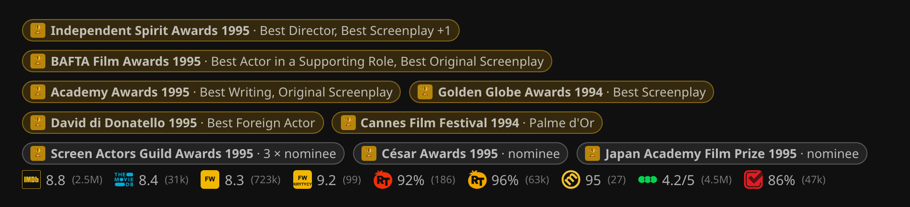
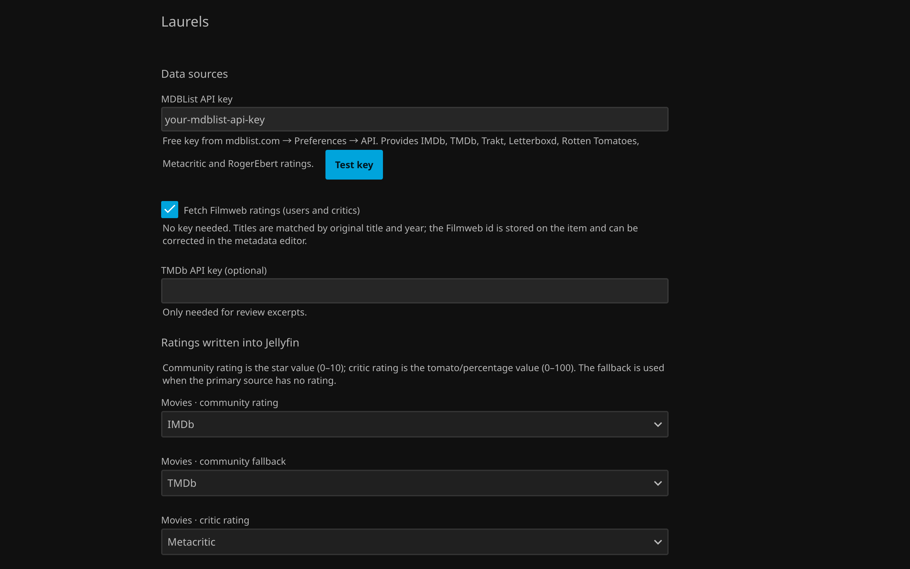

<p align="center"></p>

<p align="center">
  <a href="https://github.com/theqkash/jellyfin-plugin-laurels/releases/latest"></a>
  
  <a href="LICENSE"></a>
  <a href="https://discord.gg/CwH8XKRnpz"></a>
  <a href="https://ko-fi.com/theqkash"></a>
</p>

<p align="center"><b>Ratings from every service and the film awards behind them, right on your Jellyfin detail pages.</b><br>
IMDb, Rotten Tomatoes, Metacritic, Letterboxd, TMDb, Trakt, MyAnimeList and Filmweb, plus Oscars, Cannes, BAFTA and 22 more award families.</p>

<p align="center"></p>

## Quick install

In Jellyfin open **Dashboard > Plugins > Repositories**, add

```
https://raw.githubusercontent.com/theqkash/jellyfin-plugins/main/manifest.json
```

then install **Laurels** from the Catalog and restart Jellyfin. Details and manual install are [below](#installation).

## Works best with

| Plugin | What it adds to Laurels |
| --- | --- |
| [File Transformation](https://github.com/IAmParadox27/jellyfin-plugin-file-transformation) | the rating strip, source logos and award badges in the web interface (without it Laurels still writes ratings into Jellyfin) |
| [Home Screen Sections](https://github.com/IAmParadox27/jellyfin-plugin-home-sections) | home screen rows such as *Award winners* or *Highest rated on Filmweb* |

Both come from the repository `https://www.iamparadox.dev/jellyfin/plugins/manifest.json`; add it next to the one above.

## What it does

- **Ratings from many sources** through the MDBList API: IMDb, TMDb, Trakt, Letterboxd, Rotten Tomatoes (critics and audience), Metacritic (critics and users), RogerEbert.com, MyAnimeList.
- **Filmweb** (Polish film database): user rating and critics' rating, no API key needed. Titles are matched by original title *and* year, the Filmweb id is stored on the item and can be corrected in the metadata editor, and a Filmweb link appears in the item's external links.
- **Writes into Jellyfin's own fields**: pick which source feeds the community rating (stars) and the critic rating, with a fallback per field, separately for movies and series.
- **Awards** from Wikidata: Oscars, Golden Globes, BAFTA, Cannes, Berlinale, Venice, Emmys, César, Goya, European Film Awards, Polish Film Awards (Orły), Gdynia, Sundance, Annie, Saturn, Critics' Choice, SAG, the Razzies and more, with categories and years. No key needed. Award names and categories are shown in English or Polish, following each viewer's interface language (the plugin setting is the fallback and names the awards library).
- **Awards library**: an optional library ("Awards" or "Nagrody") with collections such as *Oscar winners* or *Cannes nominees*, kept up to date by the awards task. Which collections exist is configurable (`winners:<family>`, `nominees:<family>`).
- **Web interface** (with the [File Transformation](https://github.com/IAmParadox27/jellyfin-plugin-file-transformation) plugin): the star and tomato icons are replaced by the logo of the source actually used, a strip with all ratings appears on the detail page (each linking to its source page), and award badges show wins and nominations. Review excerpts from TMDb can be shown too (needs a TMDb API key, off by default).
- **Home screen sections** (with the [Home Screen Sections](https://github.com/IAmParadox27/jellyfin-plugin-home-sections) plugin): "Award winners", "Award nominees", "Highest rated on Filmweb / IMDb / Metacritic / Rotten Tomatoes", or per-family rows such as `winners:cannes`. Computed on the fly; no collections are created for them.

## Screenshots

| Awards and ratings | Settings |
| --- | --- |
|  |  |

## Requirements

- Jellyfin 12.0 or newer (the plugin targets .NET 10).
- Optional: File Transformation plugin (web interface additions).
- Optional: Home Screen Sections plugin (home screen rows).
- Optional: a free MDBList API key from https://mdblist.com/preferences/ (without it you still get Filmweb ratings and awards).
- Optional: a TMDb API key for review excerpts.

## Installation

1. In Jellyfin open Dashboard > Plugins > Repositories and add:

   ```
   https://raw.githubusercontent.com/theqkash/jellyfin-plugins/main/manifest.json
   ```

2. Open the Catalog, install Laurels, restart Jellyfin. The same repository also lists the other plugins from https://github.com/theqkash/jellyfin-plugins.

Manual install: download the zip from [Releases](https://github.com/theqkash/jellyfin-plugin-laurels/releases) and unpack it into `<jellyfin data>/plugins/Laurels_<version>/`.

## Getting started

1. Install the plugin (see above) and restart Jellyfin.
2. Open Dashboard > Plugins > Laurels, paste your MDBList key and choose which sources feed the community and critic ratings.
3. Run the scheduled tasks *Refresh Laurels ratings* and *Refresh Laurels awards* once (they also run on their own: daily and weekly).
4. If File Transformation is installed, reload the browser.

## Data files

Everything Laurels fetches is cached under `<jellyfin data>/laurels/` as small JSON files (one per title), so a reinstall never re-downloads everything and the plugin keeps working when a service is down. Ratings are refreshed after 365 days and awards after 180 days by default (both configurable); titles with a missing source are retried after 12 hours. The awards library lives in `<jellyfin data>/laurels/collections/`.

## API

All endpoints are under `/Laurels`:

| Endpoint | Auth | Purpose |
|---|---|---|
| `GET /Laurels/Items/{itemId}` | user | all cached ratings for an item |
| `GET /Laurels/Awards/{itemId}` | user | awards grouped by family |
| `GET /Laurels/Reviews/{itemId}` | user | review excerpts |
| `GET /Laurels/Sections` | user | home screen sections offered |
| `POST /Laurels/Items/{itemId}/Refresh` | admin | force a fresh fetch |
| `POST /Laurels/Awards/Refresh?force=` | admin | rebuild the awards index |
| `POST /Laurels/Library/Sync` | admin | rebuild the awards library |
| `GET /Laurels/Status` | admin | plugin status |
| `GET /Laurels/ClientSettings` | none | settings the web client needs |

## Building

```
dotnet build Jellyfin.Plugin.Laurels/Jellyfin.Plugin.Laurels.csproj -c Release
```

Requires the .NET 10 SDK. The output DLL plus a `meta.json` is a complete plugin. `./build-release.sh [version]` builds the zip the catalog expects and updates `manifest.json`; the GitHub workflow does the same when a tag such as `v0.1.1.0` is pushed.

## Community and support

Questions, ideas and bug reports are welcome on [Discord](https://discord.gg/CwH8XKRnpz) or in the issues here. If the plugin saves you time, you can buy me a coffee on [Ko-fi](https://ko-fi.com/theqkash).

## Credits

Brand icons come from [Simple Icons](https://simpleicons.org) (CC0). Award data comes from [Wikidata](https://www.wikidata.org) (CC0). Ratings are provided by [MDBList](https://mdblist.com) and [Filmweb](https://www.filmweb.pl). Filmweb has no public API; the plugin uses the endpoints its own website uses, which may change without notice.

## License

MIT
